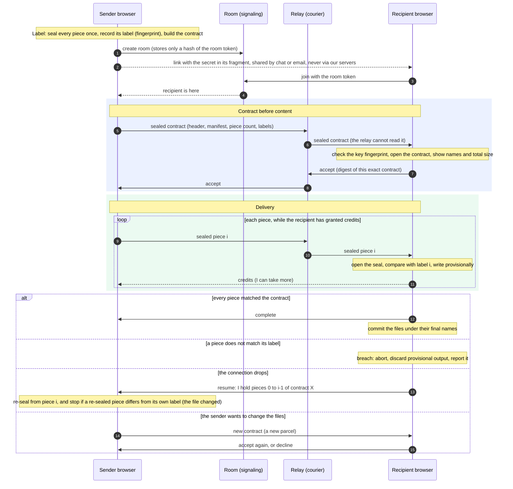
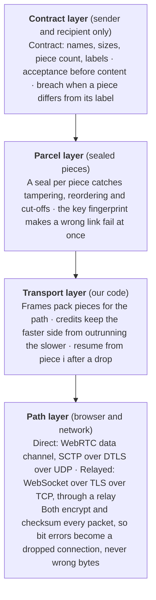

# System design

Status: hypothesis, to be confirmed by the M0 spike (see `plan.md`). Long-form research and rationale live in two Claude docs linked from `research.md`; this file is the condensed, current version.

## Requirements

The product moves a file of any size from one browser to another at the speed of the slower link, with only the sender and recipients able to read it.

| Id  | Requirement                                                                                                                                                                                                                                |
| --- | ------------------------------------------------------------------------------------------------------------------------------------------------------------------------------------------------------------------------------------------ |
| R1  | Browser-only on both ends, phone included                                                                                                                                                                                                  |
| R2  | One share link; live progress on both sides                                                                                                                                                                                                |
| R3  | Throughput limited by the slower peer, never artificially by the service on paths we do not carry                                                                                                                                          |
| R4  | End-to-end encrypted; intermediaries see only ciphertext; tampering is detected                                                                                                                                                            |
| R5  | Sizes: relayed transfers designed for 10 GB, with the relay cap chosen from 10, 25 or 50 GB after measurement; storage (phase 2) for anything larger; direct transfers limited only by the parcel cap; never buffer a whole file in memory |
| R6  | Zero-configuration NAT traversal with a fallback that always works                                                                                                                                                                         |
| R7  | Download starts before upload ends (no store-and-forward wait)                                                                                                                                                                             |
| R8  | No ads; AGPL; one-command self-hosting                                                                                                                                                                                                     |
| R9  | Node roles: any node can be endpoint, relay, store, seed                                                                                                                                                                                   |
| R10 | Scoped networks: a transfer may be limited to declared relays and stores                                                                                                                                                                   |
| R11 | Optional async mode (encrypted store) when the recipient is offline (phase 2)                                                                                                                                                              |
| R12 | Plans that track real cost: direct transfers free, relay throughput, placement and storage paid                                                                                                                                            |

## Planes

```
Key plane      sender, recipients          hold keys; encrypt, verify, decrypt
Data plane     relay, store, seed          move ciphertext they can verify but not read
Control plane  signaling, directory        pair peers, distribute policy; never touch data
```

This is Tailscale's split (coordination server, peers, DERP relays) moved to the application layer, without WireGuard: browsers cannot run it natively and recipients must not have to enrol anywhere.

## MVP architecture

```
Browsers           sender  <--- direct WebRTC --->  recipient
                      \                               /
                       signaling, relayed ciphertext
                                     |
Server parts       web assets | signaling room | relay | TURN
                   (Cloudflare Workers + Durable Objects, or workerd/celld self-hosted)
```

- Web assets: Workers static assets.
- Signaling room: a Durable Object per room (PartyServer), hibernating while idle.
- Relay: a Durable Object per transfer forwarding WebSocket messages, with credit-based flow control (there is no server-side drain API). Estimated $0.3 to $2 per TB; to be measured in M0.
- TURN: Cloudflare Realtime TURN (1,000 GB/month free) for the WebRTC NAT fallback; coturn when self-hosted.

## Transfer flow

Contract before content (ADR 0012, proposed): the sender labels every piece first, the recipient agrees to the contract, and only then does content move. Any piece that differs from the contract is a breach.



1. Sender drops files. The client generates a 256-bit secret, labels every piece (one sealing pass), requests a room (Turnstile-checked) and shows the link: `https://host/r/<room>#<secret>`. The fragment never reaches a server.
2. Recipient opens the link and joins the room. Peers exchange WebRTC offers through the signaling room.
3. Path selection (relay-first, from Tailscale): on paid plans the contract and data start on the relay at once and move to the direct path when WebRTC connects; on the free plan clients wait a few seconds for a direct path and use the relay as fallback.
4. The sender sends the sealed contract; the recipient checks the key fingerprint, shows names and total size, and accepts that exact contract.
5. Sender streams sealed pieces; the recipient opens each, compares it with its label, writes it provisionally and returns credits so the sender never outruns the slower side.
6. On a dropped connection the recipient reports the pieces it holds of contract X; the sender re-seals from there and stops if its own file no longer matches the contract. Path switches use the same mechanism.
7. When every piece matches, the recipient commits the files under their final names.
8. The signaling room counts events (created, joined, completed, direct or relayed, size bucket, failure reason) and never sees names, keys or contents.

What each layer is responsible for:



## Disk writing on the recipient

`showSaveFilePicker` on Chromium desktop; a self-hosted service-worker stream on Firefox; OPFS then save on Safari (SkySend's tiers). The resume bitmap lives in OPFS on every browser.

## Speed and latency as priced resources

| Resource           | Free                                                           | Paid                                            | Team                 |
| ------------------ | -------------------------------------------------------------- | ----------------------------------------------- | -------------------- |
| Direct transfer    | full speed, any size                                           | same                                            | same                 |
| Start              | waits briefly for direct, relay as fallback                    | relayed from the first byte, upgrades to direct | same                 |
| Relayed throughput | best effort, published per-transfer cap, shed first under load | uncapped, priority under load                   | dedicated relays     |
| Relay placement    | near the first peer                                            | location hint between peers                     | EU jurisdiction      |
| Storage (phase 2)  | none                                                           | days, hundreds of GB                            | longer, shared quota |

Rule: price only what we pay for. Throttling a path we do not carry would recreate the exact complaint this product exists to fix.

## Package layout

See `CLAUDE.md` for the kinds and import rules.

```
libraries/   parcel  transport  sink  client
services/    room  relay  quota  telemetry  abuse
platforms/   cloudflare  self-hosted
integrations/ turn  captcha  analytics
apps/        web
```

Services are declared once as Effect services with an in-memory reference layer that acts as their executable model. Each platform provides a Layer per service; one conformance suite of property-based tests runs against the model and every platform.

## Security posture

| Adversary                              | Reads contents    | Tampers undetected                         | Learns metadata                   |
| -------------------------------------- | ----------------- | ------------------------------------------ | --------------------------------- |
| Relay, seed, volunteer node            | no                | no                                         | IPs, sizes, timing                |
| Store (phase 2)                        | no                | no                                         | sizes, retention, download counts |
| Signaling                              | no                | no (key commitment, authenticated records) | who pairs with whom               |
| Hosted web operator serving JavaScript | yes, if malicious | yes                                        | everything                        |
| Anyone holding the link                | yes               | n/a                                        | n/a                               |

The web client is the real trust hole. Mitigations now: strict CSP, no third-party scripts, reproducible builds with published hashes, a public repository, self-hosting. Later: WAICT enrolment when browsers ship it, a signed CLI.

Abuse: the free path stores nothing; stores need accounts, short expiry and quotas; a report button lets a recipient voluntarily send the full link; a DSA Article 16 notice form ships in the open-source build.

## Evolution

Fixed from the MVP onward: the format, the libraries' `Transport` interface, the service declarations. Later phases add platform layers and integrations, not rewrites.

| Phase | Adds                                                                                                                                                                   |
| ----- | ---------------------------------------------------------------------------------------------------------------------------------------------------------------------- |
| 2     | Accounts (magic link), R2 store with expiry and revoke (croc's stored-transfer semantics), merchant-of-record billing                                                  |
| 3     | Own relays on Hetzner via workerd or celld (Bun fallback), coturn, self-host parity                                                                                    |
| 4     | Rust: iroh native nodes and CLI implementing the same parcel specification; signed network directory and transfer policies; seeding; PAKE short codes; team-run relays |
