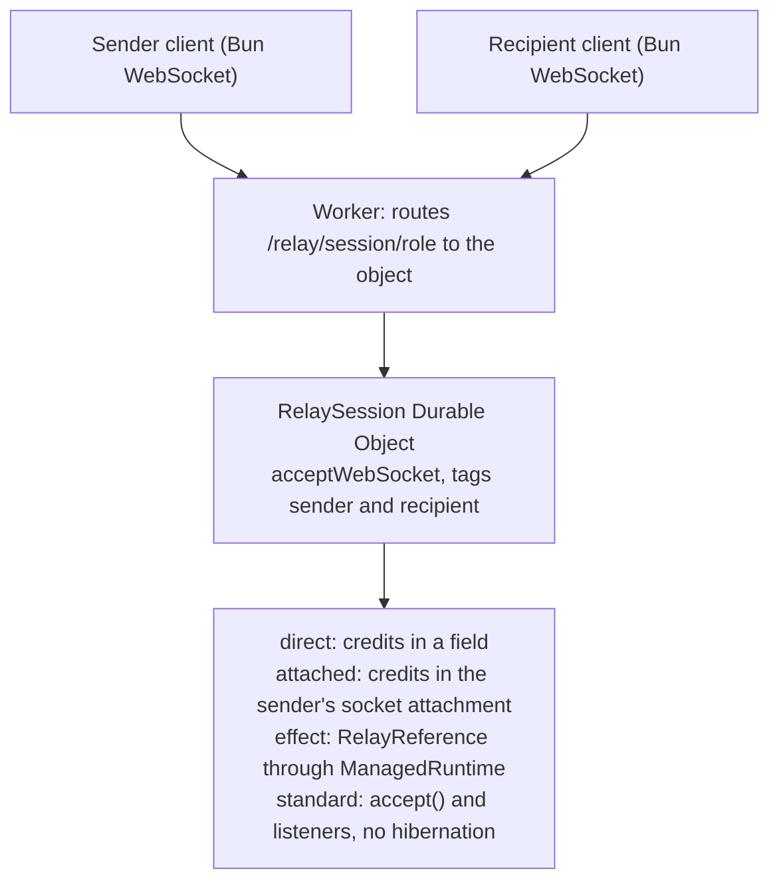

# Spike 0001: one Worker and Durable Object on workerd, Effect inside, loopback throughput

Status: done (2026-10-28). Code: `spikes/0001-workerd-durable-object/`. Raw throughput rows: `docs/spikes/data/0001-throughput.jsonl`.

Answers M0 item 4 of `plan.md` and gives a first, loopback-only throughput figure for the relay. Every number below was measured on this setup unless it says "from the docs":

- 2 vCPU, 8 GB Linux VM; client and server share the two cores.
- Plain workerd from npm `workerd` 1.20261028.1 (binary dated 2026-10-28), wrangler 4.154.0 (Miniflare ships its own workerd), Bun 1.4.4 as the client.
- Compatibility date 2026-10-01. The bundle (esbuild, 268 KB with Effect) is byte-identical under both runners.

## Summary

| Question                                     | Answer                                                                                                                                                                                                      |
| -------------------------------------------- | ----------------------------------------------------------------------------------------------------------------------------------------------------------------------------------------------------------- |
| Same code on plain workerd and wrangler dev? | Yes, the same bundle runs unchanged. Only the configuration differs (below).                                                                                                                                |
| Does hibernation happen locally?             | Yes, on both. An idle object is evicted after 10 s (9 s idle kept it, 10 s and 11 s did not); sockets stay open, attachments and `ctx.storage` survive, instance fields reset.                              |
| Effect 4 inside the object?                  | Yes. `ManagedRuntime.make(Layer.provide(RelayReference, webCrypto))` per instance, `runSync` per message. Its `Ref` state is lost on hibernation, as expected.                                              |
| Loopback throughput, one object              | 132 / 279 / 456 MB/s at 16 / 64 / 256 KiB frames (direct mode, medians of three 1 GiB runs). An upper bound, not a network number.                                                                          |
| Biggest surprise                             | WebSocket compression. The runtime negotiates permessage-deflate by default, which cut throughput to 32.8 MB/s on ciphertext. `no_web_socket_compression` restores it (8.7 times faster).                   |
| Design change                                | Flow-control state must survive hibernation: a recipient pausing more than 10 s breaks a transfer if credits live in memory. Keeping them in the sender socket's attachment fixes it at no measurable cost. |

## 1. Same code on workerd and wrangler dev

The Worker, the `RelaySession` class with `ctx.acceptWebSocket(server, [role])`, `webSocketMessage`, `webSocketClose`, `getWebSockets(tag)`, `serializeAttachment` and `deserializeAttachment` all run unchanged on both. Differences hit:

| Area               | Plain workerd (`workerd.capnp`)                                                            | wrangler dev (`wrangler.jsonc`)                                                                                                                                                  |
| ------------------ | ------------------------------------------------------------------------------------------ | -------------------------------------------------------------------------------------------------------------------------------------------------------------------------------- |
| Object declaration | `durableObjectNamespaces` with `uniqueKey` and `enableSql = true`                          | `durable_objects.bindings` plus a `migrations` entry with `new_sqlite_classes`                                                                                                   |
| Storage            | `durableObjectStorage = (localDisk = "storage")` and a writable `disk` service             | `--persist-to` directory                                                                                                                                                         |
| Bundling           | none; workerd embeds a pre-bundled module                                                  | `no_bundle: true` to run the identical artifact                                                                                                                                  |
| Compression        | `no_web_socket_compression` is honoured: no `Sec-WebSocket-Extensions` in the 101 response | still answers `permessage-deflate` with the same flag: Miniflare's entry layer negotiates it, so relay throughput under wrangler dev is 21 MB/s and says nothing about the relay |
| Runtime version    | the npm `workerd` you install                                                              | Miniflare's own nested copy, which can lag                                                                                                                                       |

Two runtime behaviours apply to both, and to Cloudflare (from the docs):

- A relay inside the Worker alone, sharing sockets through module state, fails even on single-process workerd: "Cannot perform I/O on behalf of a different request". A relay needs a Durable Object on every platform, including self-hosted workerd.
- Since compatibility date 2026-03-17, sockets taken with `accept()` deliver binary frames as `Blob` (`websocket_standard_binary_type`). Forwarding that `Blob` with `send` transmitted the string "[object Blob]", silently. Set `binaryType = "arraybuffer"` before `accept()`. The hibernation handler always receives `ArrayBuffer`.

## 2. Hibernation and Effect inside the object

Observed with `clients/hibernation.ts`, which opens both sockets, sends `probe` text frames after idle gaps, and compares the answering instance with the one that accepted the socket.

| Idle before probe      | workerd                                                                                                                        | wrangler dev  |
| ---------------------- | ------------------------------------------------------------------------------------------------------------------------------ | ------------- |
| 2 s, 8 s, 9 s          | same instance                                                                                                                  | same instance |
| 10 s, 11 s, 12 s, 15 s | new instance; sockets open; attachment still names the old instance; `ctx.storage` counter intact; per-instance counters reset | same          |

The module-level constructor counter kept counting (the isolate stayed), so only the object was evicted. Nothing should rely on that: the docs say in-memory state is discarded on hibernation, and an isolate can go too.

Effect mode builds `RelayReference` (from `services/relay`, requiring Effect's `Crypto`, provided here from Web Crypto inside the object) once per instance and drives `open`, `push`, `take`, `grant` and `meter` with `runSync` from `webSocketMessage`. Before eviction the probe finds the session (`meter` succeeds); after a wake it reports `no-session-in-this-instance`.

What breaks, measured with `clients/pauseMidTransfer.ts` (grant 8, send 4, idle, send 4):

| Mode                                                 | Pause 3 s        | Pause 12 s                                               |
| ---------------------------------------------------- | ---------------- | -------------------------------------------------------- |
| direct (credits in a field)                          | 4 of 4 delivered | 0 delivered; sender closed `1008 frame without credit`   |
| effect (credits in the reference layer's `Ref`)      | 4 of 4           | 0; sender closed `1008 NoCreditAvailable`                |
| standard (`accept()`, never hibernates)              | 4 of 4           | 4 of 4, but the object is billed for duration while idle |
| attached (credits in the sender socket's attachment) | 4 of 4           | 4 of 4                                                   |

So everything the relay needs between messages (credits, meter counters, session identity) must live in socket attachments or `ctx.storage`, not in the object or an in-memory Effect layer.

## 3. Loopback throughput

Setup: sender, object, recipient on one host. Payload is opaque random bytes from a pool of eight buffers; nothing about the bytes is logged. The recipient starts with a 2 MiB window of credits and returns them in batches of half the window. MB/s is 10^6 bytes per second, measured at the recipient from the first credit to the last byte. Server CPU and memory are for the whole workerd process, so they bound what the object used from above. The server runs at 0.92 to 0.97 of one core in every run, so these are the limits of one single-threaded object on this VM.

With compression off (`no_web_socket_compression`), 1 GiB per run, three runs per cell:

| Mode     | Frame   | MB/s median | Range          | Server CPU per MB |
| -------- | ------- | ----------- | -------------- | ----------------- |
| direct   | 16 KiB  | 132.4       | 123.5 to 136.7 | 7.44 ms           |
| direct   | 64 KiB  | 279.3       | 261.5 to 292.3 | 3.46 ms           |
| direct   | 256 KiB | 455.8       | 448.2 to 475.4 | 2.05 ms           |
| attached | 16 KiB  | 122.6       | 120.9 to 122.7 | 7.80 ms           |
| attached | 64 KiB  | 268.2       | 259.3 to 279.1 | 3.43 ms           |
| attached | 256 KiB | 415.8       | 363.8 to 435.9 | 2.24 ms           |
| effect   | 16 KiB  | 110.0       | 109.2 to 110.3 | 9.20 ms           |
| effect   | 64 KiB  | 235.4       | 228.1 to 242.7 | 4.16 ms           |
| effect   | 256 KiB | 389.4       | 387.8 to 410.7 | 2.41 ms           |
| standard | 16 KiB  | 169.6       | 166.4 to 173.7 | 5.77 ms           |
| standard | 64 KiB  | 304.8       | 276.7 to 305.2 | 3.15 ms           |
| standard | 256 KiB | 418.2       | 377.1 to 432.6 | 2.18 ms           |

A second direct batch, run next to `attached`, gave 128.3 / 305.2 / 432.0 MB/s, so differences under about 10% are noise.

Reading the table:

- **Per-message cost dominates small frames.** Direct-mode CPU fits roughly 0.1 ms per message plus 1.7 ms per MB. Fewer, larger messages are cheaper.
- **Effect costs 30 to 100 µs of CPU per frame.** That is 18 to 24% more CPU per MB and 15 to 17% less throughput than direct mode, which is acceptable for the control plane and worth avoiding on the per-frame path.
- **Attachments are free at this resolution.** Keeping credits in the attachment, with one `serializeAttachment` per frame, is within noise of in-memory credits.
- **The standard API is no faster at useful frame sizes.** It forfeits hibernation, which is what keeps idle sessions free.

With compression on (the runtime default), direct mode with 64 KiB frames over 256 MiB managed 32.5 and 31.3 MB/s (windows of 32 and 128 frames), at 28 ms of server CPU per MB. The client spent about as much again inflating and deflating. Effect mode reached 25.5 and the standard API 31.8. The window size made no difference, because both ends were CPU-bound on deflating incompressible ciphertext. A Bun relay with the same protocol and no compression reached 428 MB/s with the same client, which rules the client out as the bottleneck.

Memory: a fresh workerd process went from 53 MiB to a 206 MiB peak during a 1 GiB transfer and plateaued. A 3 GiB transfer in a long-running process peaked lower than a 1 GiB one, so memory does not grow with transfer size. Local workerd enforces no per-isolate limit, so this cannot be compared with the 128 MB isolate limit on Cloudflare (from the docs); the relay-load spike must measure it there.

## Cost per GiB relayed, from the docs (not measured)

From the Durable Objects pricing page: incoming WebSocket messages bill as requests at a 20 to 1 ratio ($0.15 per million on the paid plan), outgoing messages are free, and duration is billed at 128 MB of wall-clock time while the object is active ($12.50 per million GB-s). An object idle and eligible for hibernation is not billed for duration.

| Frame   | Sender messages per GiB | Billed requests per GiB | Request cost per GiB |
| ------- | ----------------------- | ----------------------- | -------------------- |
| 16 KiB  | 65,536                  | 3,277                   | $0.00049             |
| 64 KiB  | 16,384                  | 819                     | $0.00012             |
| 256 KiB | 4,096                   | 205                     | $0.000031            |

Duration for a transfer limited by the network to 10 MB/s is about 107 s, 13.4 GB-s, or $0.00017 per GiB, if the object counts as active for the whole transfer. Grants at one per MiB add about $0.000008 per GiB. These are list-price estimates to be checked against billing in the relay-load spike.

## What this changes

1. **Turn off WebSocket compression on every relay path** (`no_web_socket_compression` on the Worker). Ciphertext does not compress. Still unknown: whether Cloudflare's edge negotiates permessage-deflate with browsers independently of the Worker. Check the 101 response from a deployed Worker in a browser during the relay-load spike.
2. **Persist relay state in attachments or storage.** The `services/relay` model should describe its session state as a value (credits, meter counters) with pure transitions, so the reference layer can keep it in a `Ref` and the Cloudflare layer in socket attachments. Today's reference layer cannot simply be run inside the object.
3. **The object is the session.** On Cloudflare the session identity is the object (`idFromName(room)`), so `Relay.open` returning a random identifier has no counterpart there.
4. **The object forwards immediately; it has no queue.** The reference model's push-then-take queue stands for frames in flight, which a platform holds in socket buffers it cannot inspect. Credits are what bound them.
5. **Prefer larger frames.** Fewer messages cut both CPU and billed requests, and the message limit is 32 MiB (from the docs). `libraries/transport` should allow several 64 KiB records per frame (for example up to 256 KiB or 1 MiB) rather than tying frames to records. The format is unaffected.
6. **Set `binaryType = "arraybuffer"`** on every socket taken with `accept()`.
7. **Benchmark on plain workerd, not wrangler dev,** because Miniflare negotiates compression regardless of the flag.
8. **Self-hosting on workerd holds (ADR 0004).** The same object runs with local SQLite storage, and a Worker-only relay is impossible anyway.

## Not measured here

Network round trips and real links; Cloudflare's per-object CPU and the 128 MB isolate limit under load; actual billing; browser clients (which always offer compression); behaviour with several concurrent sessions per isolate. These belong to the throughput and relay-load spikes, which need the deployed Worker.
