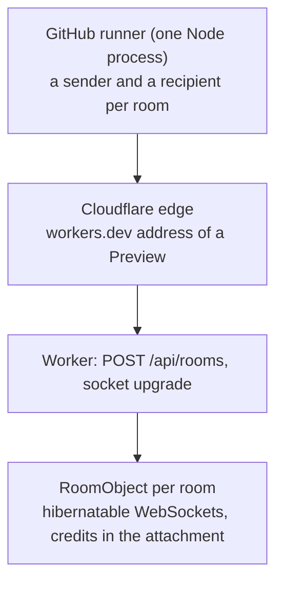

# Spike 0003: relay load on Cloudflare

Status: done (2026-10-29). Code: `spikes/0003-relay-load/load.ts`, run by `.github/workflows/relay-load.yml`. Raw rows: `docs/spikes/data/0003-relay-load-cloudflare.jsonl` (no compression) and `docs/spikes/data/0003-relay-load-cloudflare-compressed.jsonl` (clients offer permessage-deflate).

Answers the M0 item "Durable Object load test" of `plan.md` and the open questions spikes 0001 and 0002 left for Cloudflare: throughput per room, many rooms at once, a recipient that stops reading with the full 16 MiB window in flight, and the cost per GB.

The generator speaks the room protocol directly: create a room, join as sender and recipient, and move 64 KiB records under the app's credit rules (256 records in flight, credits returned in batches of 64). Bytes are random, because the relay neither knows nor cares. A slow recipient pauses its TCP socket for 20 s after the first record, so the whole window waits in the relay's path, as a phone on a bad network would.

## Setup and limits of the setup

- A Preview of the production configuration (`bun run preview loadtest`), deployed and destroyed by the workflow. Compatibility flag `no_web_socket_compression` on.
- Sender and recipient run in one Node process on one GitHub-hosted runner, so both legs share the runner's network, its CPUs and the same Cloudflare location. A real transfer has two networks and often two locations; these numbers are the relay's ceiling from one well-connected client, not what users get.
- Node with `ws` 8.18.3, because only `ws` can pause its socket (Bun's replacement cannot).
- Each scenario ran once. Variance between rooms in one run is large (below), so treat single figures as indications.

## Results without compression

| Scenario      | Rooms | Per room                | Per room MB/s, median (range) | All rooms together MB/s | Complete | Out of order | Closed early |
| ------------- | ----- | ----------------------- | ----------------------------- | ----------------------- | -------- | ------------ | ------------ |
| single        | 1     | 1 GiB                   | 28.0                          | 28.0                    | 1 of 1   | 0            | 0            |
| four          | 4     | 256 MiB                 | 38.4 (28.5 to 78.1)           | 113.9                   | 4 of 4   | 0            | 0            |
| sixteen       | 16    | 64 MiB                  | 18.3 (13.5 to 24.0)           | 203.4                   | 15 of 16 | 0            | 0            |
| slow          | 1     | 64 MiB, 20 s pause      | 3.2 (21.3 s in all)           | 3.2                     | 1 of 1   | 0            | 0            |
| slowEight     | 8     | 64 MiB each, 20 s pause | 3.05 (2.9 to 3.1)             | 23.6                    | 8 of 8   | 0            | 0            |
| slowThirtyTwo | 32    | 32 MiB each, 20 s pause | 1.5 (1.4 to 1.6)              | 45.6                    | 32 of 32 | 0            | 0            |

"All rooms together" is the bytes of all completed rooms divided by the slowest room's time.

For comparison, the same generator against plain workerd on a 2 vCPU VM (loopback, the self-hosted platform) carried four rooms at 84 to 91 MB/s each, about 350 MB/s together.

What this shows:

- **One room carries 28 to 78 MB/s on Cloudflare.** Rooms are independent: the total grew from 28 MB/s (one room) to 203 MB/s (sixteen rooms), so the single-room figure is a per-object limit, not the runner's network. Spike 0001 found the relay's cost is per message, not per byte (loopback throughput rose from 132 to 456 MB/s as frames grew from 16 to 256 KiB), which points at the 64 KiB message as the lever if one room ever needs more.
- **A stalled recipient breaks nothing.** In all 41 slow rooms the transfer resumed after the 20 s pause and completed in order, with no closes. 32 rooms each held a full 16 MiB window toward a stalled reader at once (512 MiB in total, if they shared one isolate's 128 MB, which the platform does not tell us) without an error. This suggests the 16 MiB window is safe for relay memory at this scale; it does not prove it for thousands of stalled rooms, which Cloudflare's own memory accounting would have to show.
- **One room creation in 62 failed** with Cloudflare's HTML page for error 1101 ("Worker threw exception"). Observability is off, so the cause is not recorded; a Durable Object call that throws is the only path that throws there. Fixed in the same change as this write-up: calls into Durable Objects retry once when Cloudflare marks the error `retryable` and not `overloaded` (https://developers.cloudflare.com/durable-objects/best-practices/error-handling/), and otherwise answer 503 in JSON with `retry-after: 1`; the web client asks once more after a server error. The compressed run after the fix created 21 of 21 rooms, which is too few to call the problem solved.

## Compression: Cloudflare's edge negotiates it anyway

Spike 0001 left open whether Cloudflare's edge negotiates permessage-deflate with clients regardless of the Worker's `no_web_socket_compression`. It does: a client offering `permessage-deflate` to a room on send.phibkro.org got `Sec-WebSocket-Extensions: permessage-deflate; client_max_window_bits=15` in the 101 response, and the generator's sockets negotiated it in every compressed room. Every browser offers it, and a page cannot turn the offer off, so every browser transfer through the relay compresses ciphertext that does not compress.

| Scenario | Rooms | Per room MB/s, median (range) | All rooms together MB/s | Without compression, together |
| -------- | ----- | ----------------------------- | ----------------------- | ----------------------------- |
| single   | 1     | 16.3                          | 16.3                    | 28.0                          |
| four     | 4     | 15.3 (13.3 to 16.0)           | 53.1                    | 113.9                         |
| sixteen  | 16    | 4.3 (4.3 to 4.8)              | 68.7                    | 203.4                         |

The single room lost 42%. The larger scenarios lost more, but there one Node process compresses for 16 senders and decompresses for 16 recipients, so they measure the runner's CPU more than Cloudflare. A browser compresses only its own stream. How much a browser transfer loses is not measured yet; the throughput spike (`plan.md`, M0) should measure it in real browsers through a Preview. Whether the Worker can refuse the extension at the edge is an open question for Cloudflare.

## Cost per GB, from Cloudflare's list prices

Durable Object billing (https://developers.cloudflare.com/durable-objects/platform/pricing/, read 2026-10-29): 20 incoming WebSocket messages count as one request, outgoing messages are free, duration is billed for 128 MB while the object is active and not eligible for hibernation, and there is no charge for bandwidth (https://developers.cloudflare.com/workers/platform/pricing/).

| Per GiB relayed                           | Amount                                                                    |
| ----------------------------------------- | ------------------------------------------------------------------------- |
| Incoming messages                         | 16,384 records + 256 credit messages = 16,640                             |
| Billed requests                           | 832                                                                       |
| Duration at 28 MB/s (38 s active)         | 4.8 GB-s                                                                  |
| Duration at 3 MB/s (358 s active)         | 44.7 GB-s (an upper bound: an idle object between messages is not billed) |
| Workers Paid, beyond the included amounts | $0.000125 for requests + $0.00006 to $0.00056 for duration                |

| Plan         | What limits relaying                                                                                      | About                                        |
| ------------ | --------------------------------------------------------------------------------------------------------- | -------------------------------------------- |
| Workers Free | 100,000 Durable Object requests a day (duration allows 290 to 2,700 GiB a day, so requests run out first) | 120 GiB relayed a day for the whole instance |
| Workers Paid | $5 a month includes 1 million requests (about 1,200 GiB) and 400,000 GB-s; then list prices above         | $0.19 to $0.70 per TiB beyond that           |

These are list-price calculations. Billing for the two runs (about 7.5 GiB relayed) is not itemised per Preview, so the check against an actual invoice is left to the production instance, where the operator page's "Relayed" counter now gives the volume to compare.

Sending four records per WebSocket message would cut billed requests to about 220 per GiB (about 460 GiB a day on the free plan) and, if spike 0001's frame-size result holds on Cloudflare, raise throughput per room. That is a transport framing change, not a parcel change, and needs its own measurement.

## Decisions

1. **Keep the default relay limit at 10 GB per room.** (Changed the same day at the maintainer's request: 25 GB per room, about 19,400 billed requests or a fifth of a Free day, and 50 rooms per address per hour.) A full 10 GB transfer costs about 7,750 billed requests ($0.0012 at Paid prices, 8% of a Free day), and the load test found nothing that makes longer transfers through one object risky. The share of transfers that would hit 10, 25 or 50 GB needs real usage, which the opt-in counters will show; revisit then.
2. **A per-room limit cannot protect a Free-plan instance's daily quota**: 100 rooms an hour from one address at 10 GB each is far beyond 120 GiB a day, and once the quota is spent every room on the instance fails until the next day. The protection that fits is an instance-wide daily relay budget (for example `LIMIT_RELAYED_BYTES_PER_DAY`), checked by rooms in large reservations so it adds a few requests per GiB. Built the same day as `LIMIT_RELAYED_BYTES_PER_DAY` (100 GB in Cloudflare deploys; rooms report in steps of a 400th of the budget, so 250 MB at the default).
3. **Keep the 16 MiB credit window.** 41 stalled rooms, 32 at once, completed with nothing lost.
4. **Retry Durable Object calls once when Cloudflare says they are retryable**, and answer JSON, never the platform's HTML page (done).
5. **Measure browsers through the relay with compression** in the throughput spike, and ask Cloudflare whether the edge's permessage-deflate can be refused.

## Not covered

Two real networks and two Cloudflare locations; browsers; thousands of rooms; memory as Cloudflare accounts it; billing from an invoice; the cause of the 1101 error.
