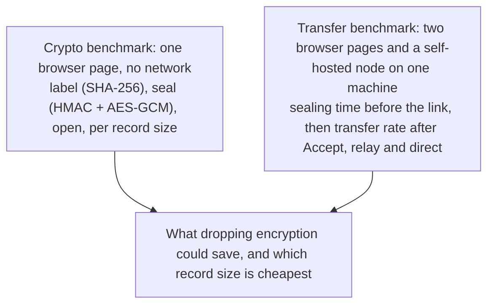

# Spike 0004: what encryption, record size and the path cost

Status: first results (2026-10-29). Code: `apps/web/scripts/benchmark.ts` and `apps/web/scripts/cryptoBenchmarkPage.ts`, run by hand or by `.github/workflows/benchmarks.yml`. Raw rows: `docs/spikes/data/0004-benchmarks-github-runner.jsonl` (GitHub's `ubuntu-latest`, 4 vCPU) and `docs/spikes/data/0004-transfers-local-vm.jsonl` (a 2 vCPU VM).

The product owner asked whether end-to-end encryption could be made opt-out for direct transfers between known parties, and for benchmarks of file sizes, parcel parameters, and relay against direct, without spending Cloudflare usage. Everything here runs against the self-hosted platform (plain workerd) on the measuring machine. `wrangler dev` is avoided because Miniflare compresses WebSocket frames (spike 0001), which made the relay look slower than it is: ADR 0022's first comparison (19.3 MB/s direct against 13.1 relayed) was against that compressed relay and is corrected below.

## Encryption cost per record

MB/s for one record at a time, as the app processes them (GitHub runner, 64 MiB per measurement; higher is better):

| Engine       | Record                      | Label (SHA-256) | Seal    | Open    |
| ------------ | --------------------------- | --------------- | ------- | ------- |
| Chromium 153 | 4 KiB                       | 399             | 188     | 206     |
|              | 16 KiB                      | 558             | 223     | 341     |
|              | **64 KiB (the app's size)** | **631**         | **287** | **334** |
|              | 256 KiB                     | 684             | 370     | 429     |
|              | 1 MiB                       | 690             | 279     | 348     |
| Firefox 155  | 4 KiB                       | 79              | 43      | 45      |
|              | **64 KiB**                  | **447**         | **203** | **304** |
|              | 256 KiB                     | 616             | 266     | 388     |
| WebKit 26.6  | **64 KiB**                  | **645**         | **369** | **427** |
|              | 256 KiB                     | 872             | 505     | 594     |
| Bun 1.4.4    | **64 KiB**                  | **656**         | **403** | **474** |

What a transfer does per byte, at 64 KiB records:

- Sender: a labelling pass before the link exists (seal, then label the sealed record), and the same again while sending, because records are sealed deterministically twice (ADR 0012).
- Recipient: label the record it received, then open it.
- Without encryption, both sides would still label every record: the labels are what make a record verifiable, resumable and repairable, and the relay "can verify but not read" through them. So dropping encryption removes seal and open, not the hashing.

|                                                              | Chromium                   | Firefox                    |
| ------------------------------------------------------------ | -------------------------- | -------------------------- |
| Transfer rate on the runner, 512 MB, relay                   | 28.7 MB/s (34.8 ms per MB) | 29.2 MB/s (34.2 ms per MB) |
| Encryption's share of the sender's time per MB while sending | 3.5 ms (10%)               | 4.9 ms (14%)               |
| Encryption's share of the recipient's time per MB            | 3.0 ms (9%)                | 3.3 ms (10%)               |
| Sealing before the link, 512 MB                              | 56 MB/s (17.7 ms per MB)   | 81 MB/s (12.3 ms per MB)   |
| Encryption's share of sealing                                | 3.5 ms (20%)               | 4.9 ms (40%)               |

So on a 4 vCPU machine, dropping encryption could make a transfer at most about 10 to 14% faster, and only when the machine's own processing, not the network, sets the pace; over a real internet path that is usually slower than 29 MB/s, the share is smaller still. The labelling pass before the link would gain more, 20% in Chromium and 40% in Firefox. These are upper bounds: the browser runs sealing, hashing and the network in parallel, so removing a step saves less than its share of the total.

## Record size

The per-record cost of Web Crypto calls dominates small records: Firefox seals 4 KiB records at 43 MB/s against 203 MB/s at 64 KiB. From 64 KiB to 256 KiB, sealing gets 29% (Chromium), 31% (Firefox) and 37% (WebKit) faster. Beyond 256 KiB it gets no faster, and Chromium gets slower.

But a record is one data channel message on the direct path, and Chrome refuses messages over 256 KiB (`max_message_size`, ADR 0022), so a 256 KiB record (plus its 23 bytes of overhead and the 9-byte frame prefix) would always fall back to the relay. 128 KiB records (exponent 17, now in the default run) are the largest that fit every browser's data channel; the next run measures them.

## Relay against direct, on one machine

Median of three transfers, after Accept (GitHub runner):

| Size   | Chromium relay | Chromium direct | Firefox relay | Firefox direct |
| ------ | -------------- | --------------- | ------------- | -------------- |
| 1 MB   | 7.1 MB/s       | 7.2 MB/s        | 6.4 MB/s      | 5.3 MB/s       |
| 16 MB  | 24.6 MB/s      | 21.5 MB/s       | 20.9 MB/s     | 13.5 MB/s      |
| 128 MB | 29.3 MB/s      | 25.7 MB/s       | 28.5 MB/s     | 21.3 MB/s      |
| 512 MB | 28.7 MB/s      | 25.6 MB/s       | 29.2 MB/s     | 24.7 MB/s      |

On one machine, for 16 MB and more, the relay is 12 to 55% faster than the direct path. That does not carry over to real networks: here both browsers and the relay share one machine's cores, and a data channel's SCTP runs inside the browsers, so it competes with sealing and opening for the same CPU, while the relay's TCP runs in the kernel and in workerd. On the 2 vCPU VM, the direct path also stalled for two to three seconds at the start of a transfer (a 16 MB transfer took 3.9 s direct against 1.2 s relayed), the data channel delivering a few records at a time before speeding up; the 4 vCPU runner did not show the stall. Whether the direct path wins between two real devices, and by how much, needs two machines on two networks, which this harness cannot do on one runner.

WebKit transfers failed in the first run because WebKit offers its private file system only to persistent profiles; the harness now gives WebKit pages one, as the end-to-end suite does, and a 1 MB transfer completes.

## Opting out of end-to-end encryption

Possible, but these numbers argue against it:

- **The gain is small.** At most about 10 to 14% of a transfer's time on a fast machine, less on a real network, because hashing stays.
- **Direct does not make it safe.** A WebRTC data channel is encrypted with DTLS, but the two browsers learn each other's DTLS fingerprints through the room, and nothing authenticates them. A compromised or malicious node (including someone's self-hosted one) can swap the fingerprints and read everything in between. Today the parcel's key travels only in the link fragment, so a server that does this still sees ciphertext. Without parcel encryption, "direct between known parties" means trusting the node that relays the signalling.
- **The relay fallback breaks the invariant.** A direct path that drops falls back to the relay mid-transfer, and the relay must never carry plaintext (CLAUDE.md). An unencrypted transfer would have to forbid that fallback, so it would fail where an encrypted one carries on.
- **It is a wire format change.** Parcel v1 is frozen. An unencrypted mode would be a new parcel version, with a downgrade question to answer (what stops a malicious server from persuading a sender to switch it off).

If speed for large files matters, the cheaper levers are larger records (up to 128 KiB on the direct path) and skipping the second sealing pass (keeping each record's ciphertext between labelling and sending, at the cost of storage). If confidentiality against the node operator on the direct path is the question, authenticating the DTLS fingerprints with a key from the link would close the gap above without touching the parcel format.

## Not covered yet

Two devices on two networks; phones; 128 KiB records (now in the default run); the stall at the start of the direct path on a small machine; Safari on macOS and iOS.
