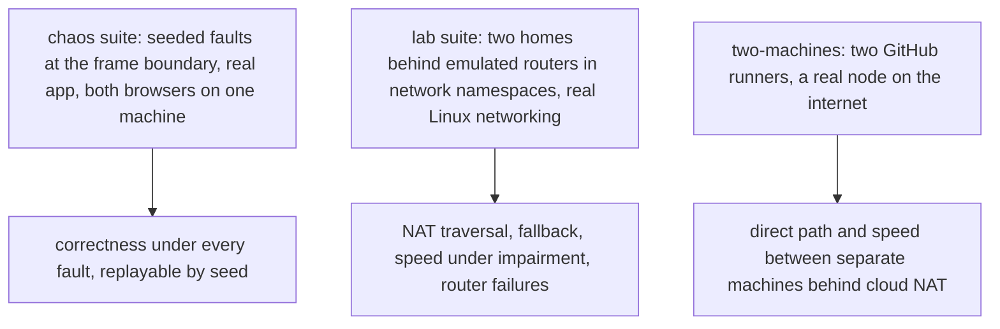

# Spike 0005: transfers on unreliable networks, simulated

Status: first results (2026-10-29). Code: the `chaos` and `lab` suites of `apps/web/scripts/endToEnd.ts`, with `apps/web/scripts/faultPlan.ts` and `apps/web/scripts/networkLab.ts`; `apps/web/scripts/remotePeer.ts` for two machines. Workflows: `chaos.yml`, `network-lab.yml`, `two-machines.yml`.

The product owner asked what "unreliable network" means for this app, and whether the conditions can be simulated instead of waiting for real devices on real networks.

## What the app can observe

Both connections are reliable transports: the room socket is TCP, the data channel reliable SCTP. Lost packets are retransmitted underneath and show up only as slowness. What the app sees, and must handle:

| On the wire                                                      | What the app sees                      | What must hold                                                     |
| ---------------------------------------------------------------- | -------------------------------------- | ------------------------------------------------------------------ |
| Loss, jitter, bufferbloat                                        | Slower throughput, stalls, bursts      | Credits keep memory bounded; a slow but live link is not a failure |
| A connection closes (server restart, close frame)                | The socket closes                      | Rejoin; resume asks only for what is missing                       |
| A connection goes silent (NAT entry gone, network change, sleep) | The socket stays open; nothing arrives | Noticed by a heartbeat, not by TCP many minutes later              |
| Records in flight when a connection ends                         | Gaps                                   | `want` re-requests exactly the gaps                                |
| Resent records                                                   | Duplicates                             | Ignored                                                            |
| Unordered data channel, or two paths                             | Reordering                             | Records land by index                                              |
| Strict NAT, blocked UDP, ICE failing mid-transfer                | No direct path, or one that closes     | The relay carries on                                               |
| A buggy or hostile relay                                         | Replayed or altered bytes              | Rejected or ignored by labels; never "complete" with wrong bytes   |

## How it is simulated

- **Chaos** routes each page's room socket through Playwright and strikes 2 to 4 faults per run (`faultPlan.ts`): clean and half-open cuts, stalls of 1 to 8 s, blackholes (the socket stays open, nothing passes), 20 to 200 ms latency, records replayed by the relay, and the direct path killed. A plan comes from a seed; a failure prints `E2E_SEED=<n> E2E_RUNS=1` to replay it.
- **Lab** builds a bridge (the internet) with the room server and a STUN server (coturn), and per side a router namespace doing NAT for a home namespace where the browser runs. Routers switch between an open NAT (endpoint-independent mapping behind a firewall that drops unsolicited packets, like a home router), a symmetric NAT (`MASQUERADE --random-fully`), and blocked UDP; they take netem delay, jitter and loss or a token-bucket rate limit, drop everything for 30 s, or move to a new address mid-transfer.
- **Two machines** runs the sender and the recipient on separate GitHub runners against a node on the internet; the payload is derived from the run's identifier, so the recipient checks every byte without the sender sending a hash.

## Findings

1. **A silent socket stalled a transfer for minutes (fixed).** The first chaos runs blackholed a recipient's socket at 29% and the transfer never resumed; nothing noticed until TCP's own timeout. Rooms now answer the text frame `ping` with `pong` through the runtime's WebSocket auto-response (without waking the Durable Object) and say so in `joined` (`answersPings`); endpoints ping after 10 s of silence and rejoin after 20 s (docs/protocol.md, "Liveness"). The same transfer now completes, and in the lab a router that drops everything for 30 s costs about 35 s in total, then the transfer finishes.
2. **24 chaos seeds pass in Chromium** after the fix (seeds 100 to 123), as do the seeds that found the bug.
3. **The lab behaves as the theory says**, in Chromium and Firefox alike (local machine, 2 vCPU, no netem module):

| Scenario                                     | Path   | Seconds      | MB/s         |
| -------------------------------------------- | ------ | ------------ | ------------ |
| Open NATs, 40 Mbit/s each way, 48 MB         | direct | 11.2 to 11.7 | 4.3 to 4.5   |
| Symmetric NATs, 16 MB                        | relay  | 1.5 to 1.6   | 10.2 to 11.1 |
| One symmetric NAT                            | relay  | 1.3 to 1.9   | 8.8 to 13    |
| UDP blocked at the sender                    | relay  | 1.4 to 1.5   | 11.2 to 12   |
| 8 Mbit/s uplink                              | direct | 17.9 to 19.5 | 0.9          |
| Sender's router drops everything for 30 s    | direct | 33.5 to 35.1 | 0.5          |
| Recipient's router moves to a new address    | direct | 11.8 to 12   | 1.4          |
| Router drops everything for 30 s, relay only | relay  | 33.8 to 34.6 | 0.5          |

Through NAT the direct path takes a second or two to open, so a small transfer on a fast relay finishes before it does; the open-NAT scenario uses a 40 Mbit/s link and 48 MB so that the transfer starts on the relay and moves to the direct path. One open and one symmetric NAT do not connect directly without a TURN relay, as expected; the room's relay carries those. 4. **Two lab artifacts, worth knowing about real routers too.** Linux records an unsolicited inbound packet (a peer's ICE check arriving before this side's own) and gives the outbound packet that follows a different external port, which breaks hole punching; Chromium happened to win that race and Firefox lost it. Home routers drop unsolicited packets in their firewall, so the lab's routers do too. Separately, Firefox gathers no usable ICE candidates on a page served from localhost, so lab pages load from the server's address with the browsers told to treat it as a secure context.

## Not covered yet

Netem scenarios (mobile data, a lossy link) need the netem kernel module and run on GitHub's runners (`network-lab.yml`); the two-machine numbers come from `two-machines.yml`. Phones, carrier NAT, corporate firewalls and Safari on iOS need real devices (docs/network-testing.md).
