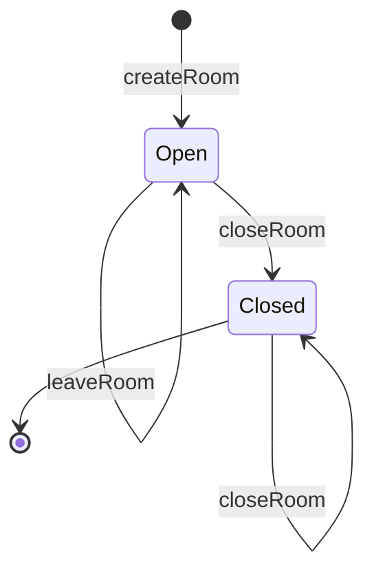
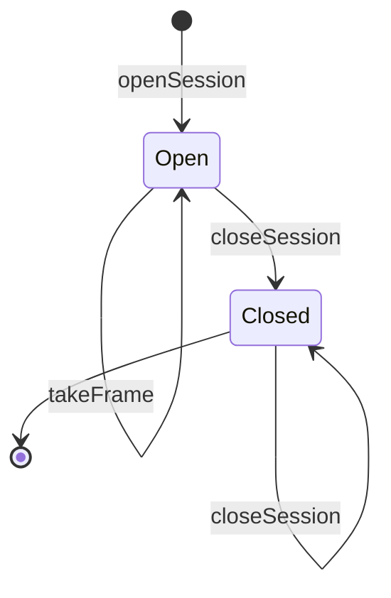

# State machines

Generated by `bun run docs:machines` from the transition tables in the code (docs/decisions/0008). Do not edit it by hand: a test fails when it is out of date.

Each machine has a diagram and a table. The table is normative: it has a cell for every state and command, so an input the diagram does not show appears there as `rejected`. A rejected command fails with a typed error and leaves the state as it was. `[*]` is the boundary, before the resource exists or after it is gone, so its row says what happens to a command on a resource that does not exist. The `follows-machine` guarantee of each service's conformance suite checks every cell, illegal ones included.

## Room (`services/room`)

| State  | createRoom | joinRoom                            | leaveRoom | closeRoom |
| ------ | ---------- | ----------------------------------- | --------- | --------- |
| [*]    | Open       | rejected                            | rejected  | rejected  |
| Open   | rejected   | Open (token matches, capacity left) | Open      | Closed    |
| Closed | rejected   | rejected                            | Closed    | Closed    |

## RelaySession (`services/relay`)

| State  | openSession | pushFrame                  | grantCredits | takeFrame | closeSession |
| ------ | ----------- | -------------------------- | ------------ | --------- | ------------ |
| [*]    | Open        | rejected                   | rejected     | rejected  | rejected     |
| Open   | rejected    | Open (a credit is unspent) | Open         | Open      | Closed       |
| Closed | rejected    | rejected                   | rejected     | Closed    | Closed       |

## Not yet tables

The browser's sender, recipient and connection life cycles are still a status field plus flags (docs/invariants.md, gap G2), so they have no table here yet.
