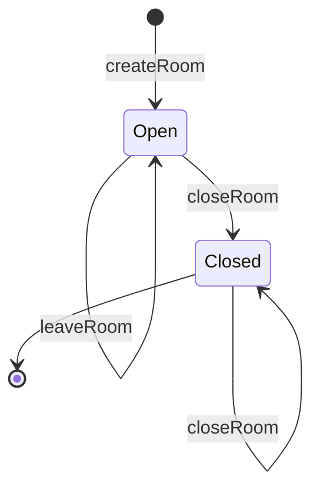
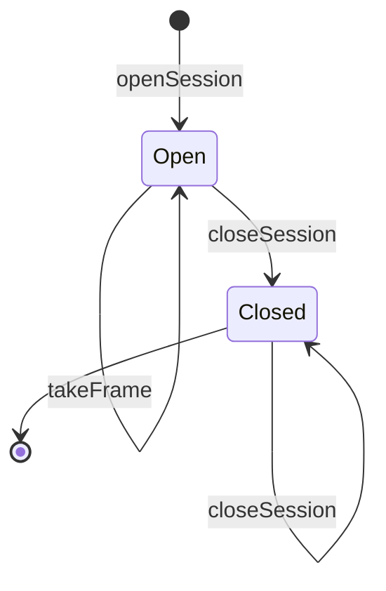
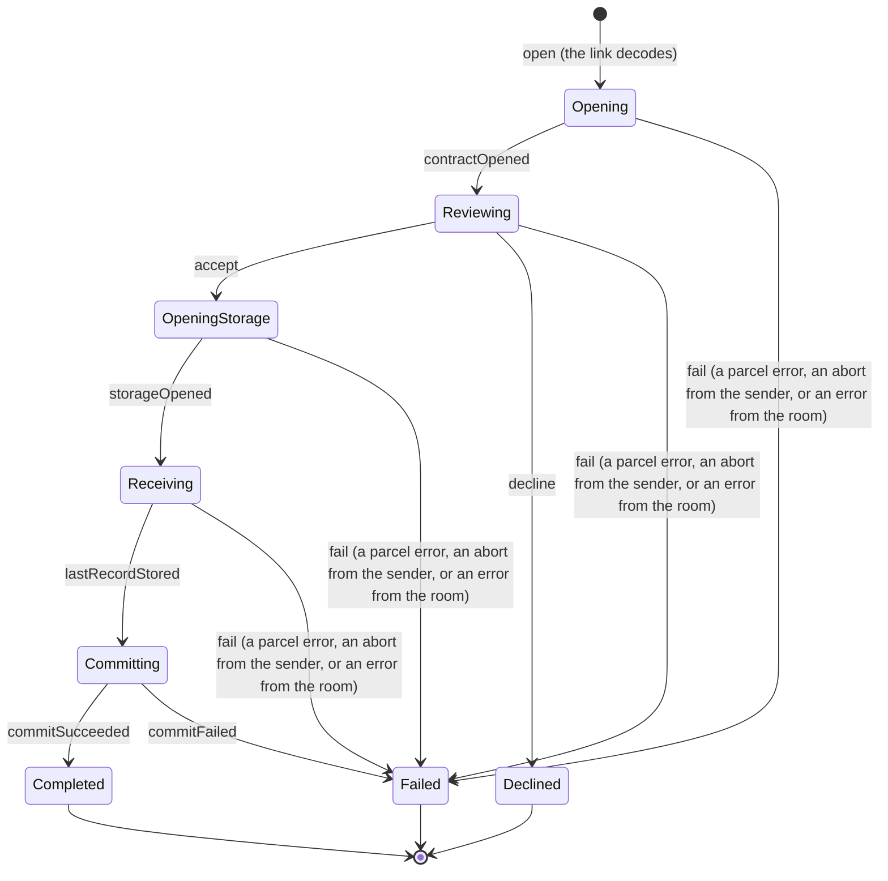

# State machines

Generated by `bun run docs:machines` from the transition tables in the code (docs/decisions/0008). Do not edit it by hand: a test fails when it is out of date.

Each machine has a diagram and a table. The table is normative: it has a cell for every state and command, so an input the diagram does not show appears there as `rejected`. A rejected command has no effect and leaves the state as it was (a service fails it with a typed error). `[*]` is the boundary, before the resource exists or after it is gone, so its row says what happens to a command on a resource that does not exist. Each section says what checks the code against its table.

## Room (`services/room`)

Checked by the `room/follows-machine` guarantee of the room's conformance suite, every cell.

| State  | createRoom | joinRoom                            | leaveRoom | closeRoom |
| ------ | ---------- | ----------------------------------- | --------- | --------- |
| [*]    | Open       | rejected                            | rejected  | rejected  |
| Open   | rejected   | Open (token matches, capacity left) | Open      | Closed    |
| Closed | rejected   | rejected                            | Closed    | Closed    |

## RelaySession (`services/relay`)

Checked by the `relay/follows-machine` guarantee of the relay's conformance suite, every cell.

| State  | openSession | pushFrame                  | grantCredits | takeFrame | closeSession |
| ------ | ----------- | -------------------------- | ------------ | --------- | ------------ |
| [*]    | Open        | rejected                   | rejected     | rejected  | rejected     |
| Open   | rejected    | Open (a credit is unspent) | Open         | Open      | Closed       |
| Closed | rejected    | rejected                   | rejected     | Closed    | Closed       |

## Recipient (`apps/web/src/recipientPhase.ts`)

Checked by `apps/web/test/recipientPhase.test.ts` (that the table is well formed, every command in a terminal phase, and the illegal cells spike 0006 found) and the browser suite's life-cycle checks (`apps/web/scripts/endToEnd.ts`), which drive the app through those cells. It is not a service, so no conformance suite checks every cell.

| State          | open                       | contractOpened | accept         | decline  | storageOpened | lastRecordStored | commitSucceeded | commitFailed | fail                                                                         |
| -------------- | -------------------------- | -------------- | -------------- | -------- | ------------- | ---------------- | --------------- | ------------ | ---------------------------------------------------------------------------- |
| [*]            | Opening (the link decodes) | rejected       | rejected       | rejected | rejected      | rejected         | rejected        | rejected     | rejected                                                                     |
| Opening        | rejected                   | Reviewing      | rejected       | rejected | rejected      | rejected         | rejected        | rejected     | Failed (a parcel error, an abort from the sender, or an error from the room) |
| Reviewing      | rejected                   | rejected       | OpeningStorage | Declined | rejected      | rejected         | rejected        | rejected     | Failed (a parcel error, an abort from the sender, or an error from the room) |
| OpeningStorage | rejected                   | rejected       | rejected       | rejected | Receiving     | rejected         | rejected        | rejected     | Failed (a parcel error, an abort from the sender, or an error from the room) |
| Receiving      | rejected                   | rejected       | rejected       | rejected | rejected      | Committing       | rejected        | rejected     | Failed (a parcel error, an abort from the sender, or an error from the room) |
| Committing     | rejected                   | rejected       | rejected       | rejected | rejected      | rejected         | Completed       | Failed       | rejected                                                                     |
| Completed      | rejected                   | rejected       | rejected       | rejected | rejected      | rejected         | rejected        | rejected     | rejected                                                                     |
| Declined       | rejected                   | rejected       | rejected       | rejected | rejected      | rejected         | rejected        | rejected     | rejected                                                                     |
| Failed         | rejected                   | rejected       | rejected       | rejected | rejected      | rejected         | rejected        | rejected     | rejected                                                                     |

## Not yet tables

The browser's sender and connection life cycles are still a status field plus flags (docs/invariants.md, gap G2), so they have no table here yet.
