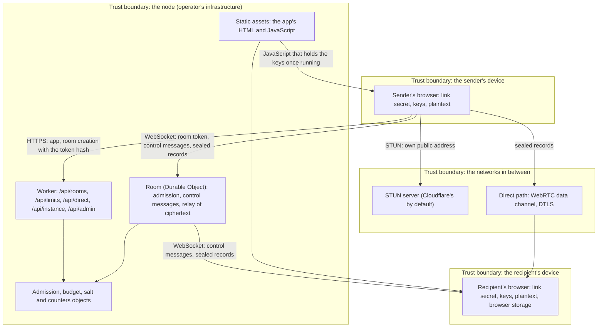

# Threat model

Structured by the four questions of the Threat Modeling Manifesto: what are we working on, what can go wrong, what are we going to do about it, and did we do a good enough job. Each threat is in scope or out of scope with a reason, and says what risk remains, as RFC 3552 asks of a protocol's security considerations. The invariants it relies on are in `invariants.md`; the wire formats in `parcel.md` and `protocol.md`.

Status: first version (2026-10-29), written from the code and the specs as they are, before any external review. It replaces the scattered notes in `design.md` ("Security posture"), `parcel.md` ("What observers learn", "Threat model notes") and ADR 0022 as the place to look; those stay as background.

## 1. What are we working on

A sender's browser seals files into a parcel under keys derived from a secret that exists only in the link's fragment. The recipient's browser opens the link, accepts the contract (names and sizes), and receives the records over a room on a node (a Cloudflare Worker with Durable Objects, or the same code on workerd), either relayed through the room or directly over a WebRTC data channel. The node also serves the app's JavaScript.

**Assets to protect:**

| Asset                                                                                     | Where it lives                                                 |
| ----------------------------------------------------------------------------------------- | -------------------------------------------------------------- |
| File contents                                                                             | Endpoints only; sealed on every path                           |
| File names, count, types                                                                  | Endpoints only; inside the sealed manifest                     |
| The link secret and the keys derived from it                                              | Endpoints only: the URL fragment, page memory                  |
| Metadata: sizes, timing, network addresses, who transfers with whom                       | Visible to the node, the networks, STUN and the other endpoint |
| Availability: the transfer completes                                                      | Depends on the node and the networks                           |
| The operator's resources: relay bandwidth, Durable Object requests, the free plan's quota | The node                                                       |
| The endpoints' devices: storage, the app's origin                                         | The browsers                                                   |

**Actors and what they can do:**

| Actor                                          | Capabilities assumed                                                                                                                |
| ---------------------------------------------- | ----------------------------------------------------------------------------------------------------------------------------------- |
| Network observer                               | Sees and records traffic between any two points; cannot break TLS or DTLS                                                           |
| Active network attacker                        | Also drops, delays, reorders and injects packets (RFC 3552's attacker with "nearly complete control of the communications channel") |
| Honest but curious node operator               | Runs the code as published and reads everything the node receives                                                                   |
| Malicious node operator, or a compromised node | Changes what the node does: drops or forges control messages, replays records, swaps WebRTC signalling, serves different JavaScript |
| Link holder                                    | Anyone the link reaches: the intended recipient, someone it was forwarded to, a messenger's preview fetcher                         |
| Malicious peer                                 | The other endpoint, or someone holding the link, sending crafted messages and records                                               |
| Third-party website                            | Can frame the app or link to it                                                                                                     |
| Supply chain                                   | Dependencies, the build, CI, the release key, the hosting provider                                                                  |

## 2. What can go wrong, and 3. what we do about it

Status: **mitigated** (an invariant holds it, see the reference), **accepted** (a known risk we choose to keep, with the reason), **open** (to be fixed; see `invariants.md`, "Gaps").

### Confidentiality

| Id  | Threat                                                                                              | Actor                                           | Response                                                                                                                                                                                                                    | Status, residual risk                                                                                                                  |
| --- | --------------------------------------------------------------------------------------------------- | ----------------------------------------------- | --------------------------------------------------------------------------------------------------------------------------------------------------------------------------------------------------------------------------- | -------------------------------------------------------------------------------------------------------------------------------------- |
| T1  | The node reads file contents or names                                                               | Honest but curious or malicious operator        | Contents and names exist on the wire only inside the sealed parcel; the node gets a room token, never the secret (C1, C2, C4)                                                                                               | Mitigated, as long as the JavaScript is honest (T3)                                                                                    |
| T2  | A network observer reads contents                                                                   | Network observer                                | TLS to the node; DTLS on the direct path; the parcel's own encryption underneath both                                                                                                                                       | Mitigated                                                                                                                              |
| T3  | The node serves JavaScript that exfiltrates the secret                                              | Malicious operator, compromised node or hosting | None in the protocol: whoever serves the app holds the keys once it runs. Partial: open source, a CSP that forbids other origins, no third-party scripts, self-hosting, the web client as a release tarball anyone can host | **Accepted for now**, and the largest residual risk. Later: verifiable builds (WAICT when browsers ship it), a signed CLI or extension |
| T4  | The node swaps the DTLS fingerprints in WebRTC signalling and sits in the middle of the direct path | Malicious operator                              | The fingerprints travel unauthenticated through the room (ADR 0022); the parcel still seals everything, so the node gains what it already sees on the relay path                                                            | Accepted: no loss beyond T1's metadata. Authenticating fingerprints with a key from the link would close it                            |
| T5  | The link leaks: forwarded, previewed by a messenger, kept in browser history                        | Link holder                                     | The secret is only in the fragment, which link-preview fetchers and servers never receive; nothing else protects a forwarded link                                                                                           | Accepted and documented (SECURITY.md: anyone holding a link can receive its files)                                                     |
| T6  | The other endpoint learns this device's network address                                             | Peer, link holder                               | The direct path exposes it, as WebRTC does; "Direct connections" off keeps every byte on the relay                                                                                                                          | Accepted, with a setting                                                                                                               |
| T7  | Metadata: sizes, timing, addresses, room membership                                                 | Node, network, STUN                             | Documented in `parcel.md` ("What observers learn"); addresses are hashed with a salt for limits and not stored (C5); no request logs (C6)                                                                                   | Accepted for live transfers; stored mode may need padding                                                                              |

### Integrity

| Id  | Threat                                                                             | Actor                                           | Response                                                                                                                                                                     | Status, residual risk                                                                           |
| --- | ---------------------------------------------------------------------------------- | ----------------------------------------------- | ---------------------------------------------------------------------------------------------------------------------------------------------------------------------------- | ----------------------------------------------------------------------------------------------- |
| T8  | Records are altered, truncated, reordered, replayed or spliced from another parcel | Active attacker, malicious node, malicious peer | Every record is checked against the contract's labels before it counts (I1); the key commitment rejects a wrong link early (I2); chaos runs replay records through the relay | Mitigated                                                                                       |
| T9  | Another site frames the app and tricks the user into clicking                      | Third-party website                             | The CSP is a `<meta>` tag, which cannot set `frame-ancestors`; no header forbids framing the app's pages                                                                     | **Open** (G3): add `frame-ancestors 'none'` as a header, keeping `'self'` for the preview frame |
| T10 | A received file runs as a page on the app's origin when previewed                  | Malicious peer                                  | Previews render in a sandboxed, opaque-origin frame with its own CSP; HTML shows as text (C7)                                                                                | Mitigated                                                                                       |
| T11 | A forged `accept`                                                                  | Malicious node                                  | The digest is computable from public bytes, so a relay can forge it; acceptance only gates when content flows                                                                | Accepted while that holds (G4); MUST be MACed before acceptance authorizes anything             |
| T12 | An older contract is served whole to a recipient who never saw the newer one       | Malicious node or store                         | Live transfers: the sender's presence decides the current contract                                                                                                           | Accepted for live transfers; stored mode needs a signed "latest contract" pointer (`parcel.md`) |
| T13 | Crafted wire input crashes or hangs a decoder                                      | Malicious peer or node                          | Schemas at every boundary (I5); the parcel's decoders are property-tested; CodeQL found and we fixed one polynomial regex (PR #5)                                            | Mitigated in part; fuzzing is open (G5)                                                         |

### Availability and resources

| Id  | Threat                                                             | Actor                    | Response                                                                                                                        | Status, residual risk                                                                              |
| --- | ------------------------------------------------------------------ | ------------------------ | ------------------------------------------------------------------------------------------------------------------------------- | -------------------------------------------------------------------------------------------------- |
| T14 | A connection drops, goes silent, or a path fails mid-transfer      | Network, active attacker | Rejoin and resume (L1), liveness pings (L2), fallback to the relay (L3), stall repair (L4); covered by the chaos and lab suites | Mitigated; an attacker who blocks the node blocks the transfer, as for any relayed service         |
| T15 | A link holder joins as sender or recipient and evicts the real one | Link holder              | Newest join wins, the evicted side is told and stops (L5); every link holder can do this by design                              | Accepted: the link is the capability. Rooms with several recipients will need recipient identities |
| T16 | Someone drains the operator's relay quota or creates rooms in bulk | Anyone                   | Per-address room limit (R3), per-room and per-day relay budgets (R2), the daily budget refusing with 429 until midnight UTC     | Mitigated in part; Turnstile (opt-in) is planned for public instances                              |
| T17 | The service is used to distribute illegal content                  | Abusers                  | The free path stores nothing and needs both parties online; reports and the DSA notice form are planned (plan, M3b)             | Open: no `/abuse` page yet                                                                         |

### Supply chain and operations

| Id  | Threat                                                    | Actor        | Response                                                                                                         | Status, residual risk                                          |
| --- | --------------------------------------------------------- | ------------ | ---------------------------------------------------------------------------------------------------------------- | -------------------------------------------------------------- |
| T18 | A compromised dependency or build step ships hostile code | Supply chain | Pinned lockfile, Dependabot, CodeQL, gitleaks, required checks on main, release builds from tags only, checksums | Mitigated in part; no reproducible-build verification yet      |
| T19 | The release deploy key leaks and pushes to main           | Supply chain | The key lives in a `release` environment that only main can use; pull request runs cannot read it                | Accepted; a GitHub App with short-lived tokens would narrow it |
| T20 | The admin endpoints are reached by someone else           | Anyone       | `ADMIN_TOKEN` compared in constant time; optional Cloudflare Access in front                                     | Mitigated                                                      |

### Out of scope

| Threat                                             | Why                                                                                                                 |
| -------------------------------------------------- | ------------------------------------------------------------------------------------------------------------------- |
| A compromised sender or recipient device           | It holds the plaintext by definition (SECURITY.md)                                                                  |
| Breaking AES-256-GCM, SHA-256, HKDF, TLS or DTLS   | Standard primitives, used as specified; the parcel's use of them awaits a human cryptography review (plan, M1)      |
| Traffic analysis of an endpoint's own network link | Sizes and timing are visible by design (T7); hiding them needs padding and cover traffic the product does not offer |

## 4. Did we do a good enough job

Not yet in four ways, which are the open items above and the gaps in `invariants.md`:

1. **T3, the served JavaScript, is the largest residual risk** and has no protocol answer; it is the reason self-hosting and a published client matter.
2. **T9 (framing) and T17 (abuse reports) are open** and small to close.
3. **The room's guarantees are proven for the model, not the deployed platform** (G1), and the endpoints' life cycles are implicit (G2), so some illegal states have no test.
4. **No external review.** Parcel v1 had two agent reviews (ADR 0011); a human cryptography review is planned before launch, and this threat model is the brief to hand that reviewer.

This document changes with the code: a pull request that adds a path, a message, an endpoint or a stored value says in its description which threats it touches, and updates this file when it adds or closes one.
