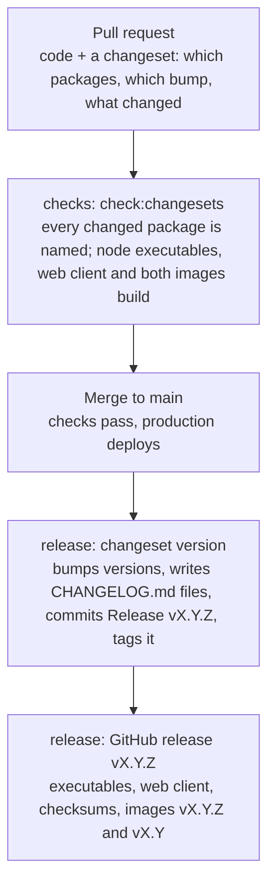

# Versions and changelogs

Every package in this repository has a [semantic version](https://semver.org/spec/v2.0.0.html) and a `CHANGELOG.md`, written by [Changesets](https://changesets.dev) from the changeset each pull request adds. The root `CHANGELOG.md` collects every release in one place. Decided in ADR 0023.

## Adding a changeset

Run `bunx changeset` in your branch, choose the packages you changed and a bump for each, and describe the change in a sentence or two a user of that package would understand. Commit the file it writes in `.changeset/`.

- A pull request that ships nothing (documentation, tests, CI, repository tools) adds an empty changeset: `bunx changeset --empty`, with a sentence saying what it does. Dependabot's updates are the one exception, because Dependabot cannot write one: they may leave it out when they change no shipped file, and a maintainer adds the changeset when they do.
- `bun run check:changesets` runs the same check as CI: it fails when the pull request adds no changeset, or changes a package's shipped files (anything but `test/`, `scripts/`, `*.test.ts`, `README.md` and `CHANGELOG.md`) without naming that package. It lists the bumps of seam packages for the reviewer.
- Write what changed for the people who use the package, not how: "Recipients can rename a file before saving" rather than "Add nameField".

## Two version lines

| Line        | Packages                                                                         | Version           | Released as                                                                                              |
| ----------- | -------------------------------------------------------------------------------- | ----------------- | -------------------------------------------------------------------------------------------------------- |
| The product | `apps/web`, `platforms/*`, `services/*` (one version, Changesets' `fixed` group) | `vX.Y.Z`          | Git tag `vX.Y.Z`, GitHub release with the node executables and web client, container `vX.Y.Z` and `vX.Y` |
| Libraries   | `libraries/*`, each on its own                                                   | `<package>@X.Y.Z` | Git tag only; other clients build against these                                                          |

A library change also bumps the packages that depend on it (a patch, "Updated dependencies"), so the product releases whenever a library it ships changes. `tools/*` is never versioned.

## Which bump

| Bump  | When                                                                                                                                                             |
| ----- | ---------------------------------------------------------------------------------------------------------------------------------------------------------------- |
| major | A user of the package must change something: a seam stops accepting what it accepted, a setting or endpoint is removed or renamed, a function's meaning changes. |
| minor | Something new that existing users can ignore: a new optional field, message, endpoint, setting or function, a new parcel version alongside the old ones.         |
| patch | Nothing a user can rely on changes: fixes that restore documented behaviour, performance, wording.                                                               |

Until the product reaches 1.0.0, a breaking change to the product bumps the minor version, as SemVer allows for 0.x versions; major is kept for the decision to call it 1.0.0. The seam libraries below start at 1.0.0 and follow the table strictly from the start, because other clients depend on them.

## Seams

A seam is a contract between pieces built and deployed independently: a recipient's browser and a sender's, an old client and a new server, another implementation of the parcel. Their versions carry the most weight, and `check:changesets` lists their bumps on every pull request.

| Seam                                                                                                                           | Package                                        | Breaking (major)                                                                                                                                           | Additive (minor)                                                                     |
| ------------------------------------------------------------------------------------------------------------------------------ | ---------------------------------------------- | ---------------------------------------------------------------------------------------------------------------------------------------------------------- | ------------------------------------------------------------------------------------ |
| Parcel format (`docs/parcel.md`)                                                                                               | `@file-transfer/parcel`                        | Anything that changes the bytes of a frozen format version, or drops reading one. A frozen version is never edited (CLAUDE.md); a change is a new version. | A new parcel version that readers accept alongside the existing ones.                |
| Room protocol (`docs/protocol.md`): control messages, unit frames, close codes                                                 | `@file-transfer/transport`                     | Removing or renaming a message or field, making an optional field required, changing a frame or close code's meaning.                                      | A new message or optional field older endpoints ignore (decoders drop unknown keys). |
| Server HTTP API (`/api/*`), operator settings (environment variables, `wrangler.jsonc`), Durable Object classes and migrations | `@file-transfer/platform-cloudflare` (product) | Removing or renaming an endpoint, response field, setting or Durable Object class; changing a default in a way an operator would notice.                   | A new endpoint, response field, setting or Durable Object class.                     |

## Releases

Releases happen on their own (`.github/workflows/release.yml`): when `checks` passes on a push to main and changesets are waiting, the release workflow runs `changeset version`, writes the notes (`bun run release:prepare`), commits `Release vX.Y.Z` to main with its tags, builds and smoke-tests the executables on every platform and both container architectures, and publishes the GitHub release. A push with only empty changesets releases nothing; their files go with the next release.

The release commit is pushed by GitHub Actions, so it does not run `checks` again; it changes only versions and changelogs.
